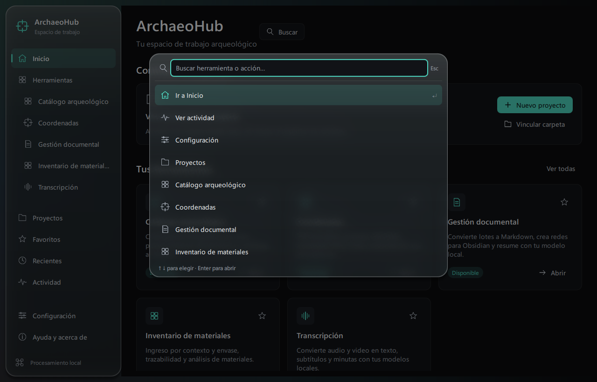

# ArchaeoHub

Hub de herramientas arqueológicas con **C++20, Qt 6 y QML**. Integra herramientas
independientes dentro de una misma interfaz y mantiene el procesamiento local.

## Herramientas

- **Catálogo fotográfico:** contexto arqueológico, miniaturas, visor con zoom bajo
  el cursor, carga de catálogos existentes y exportación Excel.
- **Coordenadas:** PROJ, CRS por EPSG, 201 accesos predefinidos, zonas UTM,
  conversión individual o por lotes e importación/exportación XLSX/CSV.
- **Transcripción:** audio y video, Whisper/Parakeet, subtítulos y minutas.
- **Gestión documental:** PDF con texto, DOCX y Markdown; conversión a Markdown,
  resúmenes con un modelo local y biblioteca para Obsidian con evidencia de enlaces.
- **Inventario:** trazabilidad, cantidades, importaciones conservadas y tablas
  CSV/XLSX. No se certifica conformidad con una plantilla digital oficial del MNCR.

Incluye proyectos con estructura de carpetas, favoritos, actividad, registro de
volúmenes, temas claro/oscuro/sistema y opciones de accesibilidad. Los motores se
cargan al utilizarlos. El vidrio difumina el fondo de la aplicación; los formularios
y tablas conservan superficies sólidas.

## Estado

Versión de referencia **0.5.4**. La aplicación completa y el instalador han sido
compilados y probados localmente en **Windows x64**. Linux y macOS son objetivos
de portabilidad; todavía no se afirma una validación completa allí. La CI propuesta
comprueba contratos del Core y pruebas Python, no la aplicación completa por SO.

Este repositorio contiene fuentes y pruebas; no incluye instaladores, fotografías,
audios, bases arqueológicas ni pesos grandes de IA. Los dos recursos ONNX pequeños
de preprocesamiento/VAD conservan sus atribuciones MIT en [THIRD_PARTY.md](THIRD_PARTY.md).
Ollama y los modelos para resúmenes son dependencias locales opcionales, no incluidos.
OCR y lectura de Word binario `.doc` están pendientes.

## Compilar y colaborar

- [Compilación y modos de pruebas](BUILDING.md)
- [Arquitectura](ARCHITECTURE.md) y [módulos](MODULES.md)
- [Pruebas y alcance verificado](docs/TESTING.md)
- [Contribuir](CONTRIBUTING.md) y [seguridad](SECURITY.md)
- [Preparación de publicaciones](docs/PUBLISHING.md)

El Core puede compilarse sin el SDK de transcripción. La aplicación completa
requiere preparar los SDK y los motores descritos en BUILDING.md; no hay descargas
silenciosas al arrancar ni una dependencia de las carpetas del desarrollador.

## Licencia

El código propio de ArchaeoHub se publica bajo [MIT](LICENSE), según la decisión
del titular. Las dependencias, código adaptado y recursos de terceros conservan
sus licencias; MIT no las sustituye. Consulta [THIRD_PARTY.md](THIRD_PARTY.md).
